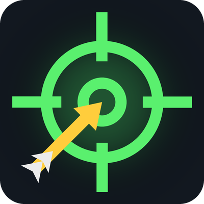

# Forever Rotation

Small helper for **WoW Forever** (Interface 16001):

- **Next-spell suggestion for every class**: highlights the button on your bars and shows a square
  between your unit frames with the spell, your key bind and its damage. Priorities follow the Forever
  leveling guides:
  - **Hunter** – Mark and Sting only on mobs that live, Aimed Shot vs Multi-Shot by damage, hawks,
    melee weaving, aspect reminder, range zone icon by the nameplate.
- Long cooldowns on a second square with an orange frame, so they never hide the next spell.
- In a dungeon, when you are the group's top damage on a boss (numbers from Details!): a small
    panel offers a party chat line, one click posts it (once per run; off in Settings).
  - **Warrior** – Shout, Charge, Victory Rush, Execute / Overpower / Revenge, Mortal Strike / Bloodthirst,
    Rend, AoE on packs, Heroic Strike only with spare rage, interrupts.
  - **Rogue** – openers, Slice and Dice, Shank, Sinister Strike to 5 points, Eviscerate, cooldowns, Kick.
  - **Mage** – Frost / Fire / Arcane, Frost Nova when caught, Ice Lance on frozen, procs, Evocation, wand.
  - **Warlock** – Banes and DoTs, Immolate / Conflagrate / Shadowburn, Wrack, Life Tap, Drain Life / Soul.
  - **Priest** – Shield, Pain, Mind Blast, Devouring Plague, Mind Flay / Smite, self-heals.
  - **Paladin** – aura, Might, seals and Judgement, Holy / Crusader Strike, Exorcism, Consecration.
  - **Shaman** – imbue, Lightning Shield, Stormstrike, Maelstrom bolts, totems, shocks, Lava Burst.
  - **Druid** – cat, bear and caster / Moonkin rotations, Mark of the Wild, self-heals.

  Mana / healing potions and self-heal spells when you're low. Hunter and Warlock have been played
  with the addon; reports for the other classes are very welcome (`/frot trace` logs decisions).
- **Damage-per-second numbers on your action buttons** (any class): expected damage of one press
  divided by the time it costs you. Instant spells count as one global cooldown (1.5 s); cast-time
  spells count their cast. Read from the spell's tooltip plus your weapon damage, attack power and crit.
  The same number is added to spell tooltips.

Numbers are estimates: no hit, armor or resistances; crits counted as double damage; spell power
is not added for casters.

## Commands

`/frot` – settings window (also the minimap button and the addons menu)
`/frot labels | glow | icon | potions` – toggle features
`/frot unlock` / `/frot lock` – move the icon
`/frot scale 1.2` – icon size
`/frot debug` – print what the addon reads from your buttons
`/frot trace` – keep a log of the addon's decisions (SavedVariables, for bug reports)
`/frot spells` – save your spellbook with spell ids (for bug reports and translations)
`/frot aggro` – what the aggro data log has collected

The addon only shows what to press; you press every key yourself.

## License

MIT
