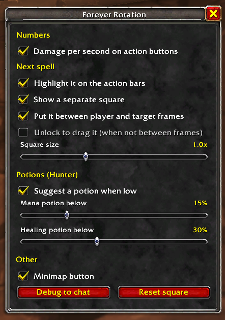

# Forever Rotation

Small helper for **WoW Forever** (Interface 16001):

- **Next-spell suggestion for Hunters**: highlights the button on your bars and shows a square between
  your unit frames with the spell, your key bind and its damage.
  Multi-Shot on 2+ enemies, no Serpent Sting on mechanicals or dying trash, Hunter's Mark only on
  targets that will live, Aimed Shot vs Multi-Shot picked by damage, mana/healing potion when low,
  and a reminder to switch to Aspect of the Hawk when you shoot in Cheetah.
- **Damage-per-second numbers on your action buttons** (any class): expected damage of one press
  divided by the time it costs you. Instant spells count as one global cooldown (1.5 s); cast-time
  spells count their cast. Read from the spell's tooltip plus your weapon damage, attack power and crit.
  The same number is added to spell tooltips.

Numbers are estimates: no hit, armor or resistances; crits counted as double damage; spell power
is not added for casters.

## Commands

`/frot` – settings window (also the minimap button and the addons menu)
`/frot labels | glow | icon | potions` – toggle features
`/frot unlock` / `/frot lock` – move the icon
`/frot scale 1.2` – icon size
`/frot debug` – print what the addon reads from your buttons

The addon only shows what to press; you press every key yourself.

## License

MIT
